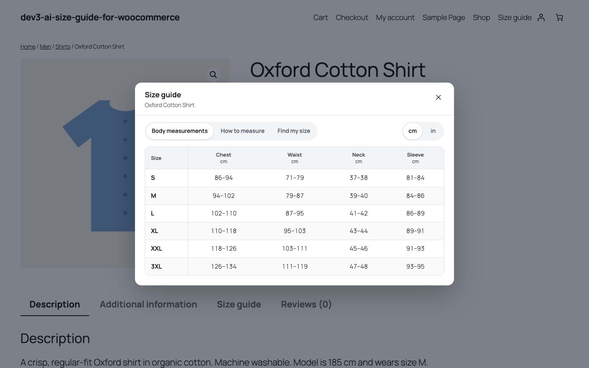

# DEV3 AI Size Guide & Fit Advisor for WooCommerce

Size charts with a cm/in switch, a "What size am I?" quiz, a phone-friendly bottom sheet, DEV3 AI chart drafting and learning from return reasons.



## Features

DEV3 AI Size Guide & Fit Advisor helps shoppers pick the right size the first time and helps you see which styles run small or large.

**Size charts (no AI needed)**

* Grid editor with several tables per chart (body, garment, international sizes), ranges such as 86-91, edit in cm or inches.
* 12 ready-made templates: women's tops, dresses, bottoms, men's tops, jeans, unisex tees, women's and men's shoes, kids, bras, rings, hats.
* Paste a supplier table (tab, comma, semicolon or space separated) and import it without AI; inches are detected and converted.
* Assign by category (sub-categories included), tag, product, exclusions and priority, plus a per-product override.
* How-to-measure guide with an image and a shopper fit note.

**On the storefront**

* "Size guide" and "What size am I?" buttons near add to cart, a product tab, or both.
* A centred dialog on desktop and a real bottom sheet on phones (swipe down, Escape, focus trap, safe areas).
* Tables scroll in both directions with a sticky header row and sticky size column; cm/in switch remembered per device.
* Works with block themes (Twenty Twenty-Five) and classic themes (Twenty Twenty-One).
* Shortcodes `[dev3sg_size_guide]`, `[dev3sg_size_chart]`, `[dev3sg_fit_quiz]` and the **Size Chart** block.

**"What size am I?" quiz**

* Pure measurement maths: chest, waist, hips, foot length and every other measure in your chart, fit preference, the size usually worn in US/UK/EU, or a height-and-weight estimate.
* Recommended size, an alternative when between sizes, confidence, per-measure verdicts and "Select this size" for the variation dropdown.
* DEV3 AI can rewrite the explanation in friendly words (cached, rate-limited, with a written fallback).

**Returns-reason learning**

* Reads WooCommerce refund reasons, a "Fit feedback" box on orders (HPOS and legacy), manual records and the `dev3sg_record_return` action.
* Classifies "too small / too large" in several languages; DEV3 AI can classify unclear notes (you accept each suggestion).
* When a style keeps coming back one way, you get a "runs small / large" suggestion; accepting it moves the quiz one size and can add a shopper note.

**DEV3 AI (Google AI, your own key)**

* Draft a full chart from product data, a pasted chart or a photo / screenshot of a supplier chart.
* Write the how-to-measure guide, summarise return notes and suggest category assignments.
* Everything is a draft until you accept it. The plugin works fully without AI or a key.

## Requirements

- WordPress 6.0 or newer (tested up to 6.8)
- PHP 7.4 or newer
- WooCommerce 8.0 or newer (required)
- Optional: your own Google AI API key (from Google AI Studio) to switch on the DEV3 AI features. The rest of the plugin works without one.

## Installation

### From the release zip

1. Download `dev3-ai-size-guide-for-woocommerce.zip` from the [latest release](https://github.com/dev3tech/dev3-ai-size-guide-for-woocommerce/releases/latest).
2. In WordPress, go to **Plugins → Add New → Upload Plugin**, choose the zip and click **Install Now**.
3. Click **Activate**.

### Build from source

```bash
git clone https://github.com/dev3tech/dev3-ai-size-guide-for-woocommerce.git
cd dev3-ai-size-guide-for-woocommerce
composer install --no-dev
npm ci
npm run build
```

Then copy the `dev3-ai-size-guide-for-woocommerce` folder into `wp-content/plugins/` and activate it.

### Getting started

1. Upload the plugin zip under Plugins → Add New → Upload Plugin and activate it (WooCommerce must be active).
2. Open **DEV3 AI Size Guide** → Templates and create your first chart, then assign it to categories under "Where it shows".
3. Optional: add a Google AI API key under API Config to turn on the DEV3 AI features.

## FAQ

### Does it work without AI?
Yes. Charts, templates, paste import, the quiz maths, analytics and return learning all work without a key.

### Which data is sent to Google AI?
Only for the features you use: product title, categories, description and size options (chart drafts), pasted text or the image you upload, the quiz result (no names or emails) and masked return notes.

### Where are shopper measurements stored?
Only in the shopper's browser when they tick "Remember my measurements". The server keeps anonymous counts only.

### Is it compatible with HPOS and the Cart/Checkout blocks?
Yes, both are declared and supported.

## Documentation

The full HTML guide (installation, settings, hooks and FAQ) is in [`docs/index.html`](docs/index.html). Open it in a browser after cloning or downloading the repository.

## Changelog

### 1.0.0
* Initial release.

## Licence

Released under the GNU General Public License v2.0 or later (GPL-2.0-or-later). See [LICENSE](LICENSE).

## More from DEV3

- [DEV3 AI Size Guide & Fit Advisor for WooCommerce on the DEV3 Marketplace](https://www.dev3.tech/item/dev3-ai-size-guide-for-woocommerce)
- [More WordPress plugins, themes and templates from DEV3](https://www.dev3.tech/marketplace)
